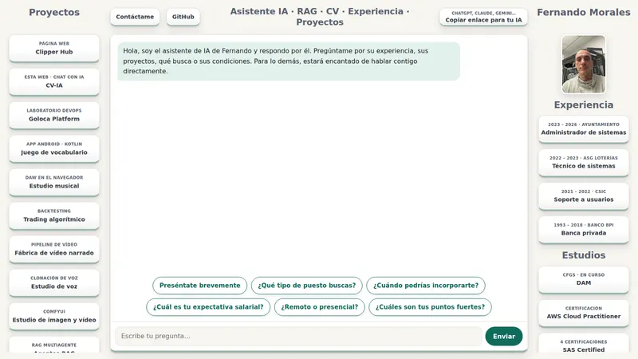
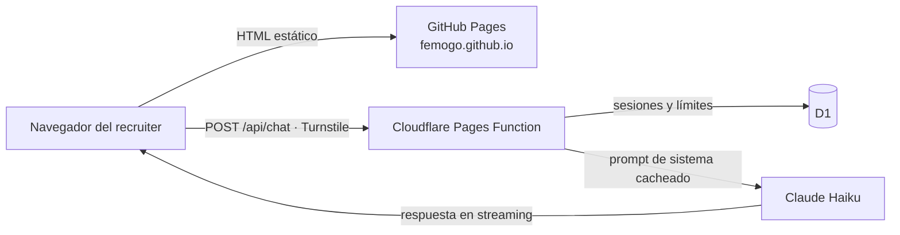

# CV-IA · Entrevista a mi asistente

**👉 [femogo.github.io](https://femogo.github.io)**

Mi CV, con un chat en el que una IA responde por mí en primera persona, a cualquier hora, **solo con lo que yo he escrito** en mi base de conocimiento. Si algo no está ahí, no lo inventa: te propone hablarlo conmigo.

Soy **Fernando Morales**, administrador de sistemas evolucionando a DevOps (Madrid). Si eres recruiter, pregúntale lo que le preguntarías a un candidato: experiencia, proyectos, disponibilidad, condiciones…

> Este repositorio contiene solo la **web ya construida** que sirve GitHub Pages. El código fuente está en un repositorio privado, porque la base de conocimiento incluye datos personales.

## Cómo funciona

- **Web estática con Astro**: HTML y CSS, con muy poco JavaScript (solo el chat).
- **API en Cloudflare Pages Functions**: la clave de Anthropic vive solo en el servidor. El navegador nunca habla con el modelo directamente.
- **Sin base de datos vectorial, a propósito.** Toda la base de conocimiento cabe en el prompt de sistema y va con *prompt caching*. El modelo la ve entera en cada pregunta, así que no hay fallos de recuperación y cada consulta sale barata. Si un día crece demasiado, el paso siguiente sería RAG con embeddings.
- **Reglas de la IA**: responde solo con hechos de la base de conocimiento, se presenta como asistente IA que habla en mi nombre, contesta en el idioma de quien pregunta y no acepta instrucciones que intenten cambiar su papel.
- **[`llms.txt`](https://femogo.github.io/llms.txt)**: la misma información en texto plano. El botón «Copiar enlace para tu IA» sirve para pasársela a ChatGPT, Claude u otro asistente.

## Protección contra abuso

Es una web pública que llama a un modelo de pago, así que el gasto está acotado por capas:

| Capa | Qué hace |
|---|---|
| Cloudflare Turnstile | Comprueba que hay una persona antes de abrir una sesión |
| Sesiones en D1 | Máximo 20 preguntas por sesión, contadas en el servidor |
| Límite por IP | Tope diario por IP; la IP no se guarda, solo un hash que cambia cada día |
| Tope global | Máximo de preguntas al día entre todos los visitantes |
| Origen | La API solo acepta peticiones de esta web (CORS para este dominio) |
| Respuestas | `max_tokens` bajo e historial recortado |
| CSP | Solo se ejecutan los scripts propios y Turnstile |
| Anthropic | Límite de gasto mensual en la cuenta |

## ¿Por qué GitHub Pages y no Cloudflare?

La web nació en `cv-fernando.pages.dev`, pero LinkedIn marca ese dominio como «posible contenido malicioso» y no genera la vista previa. Por eso la parte estática se sirve desde GitHub Pages, y la API sigue en Cloudflare.

## Stack

Astro · TypeScript · Cloudflare Pages Functions · Cloudflare D1 · Cloudflare Turnstile · Claude API (Haiku, prompt caching, streaming) · GitHub Pages · Desarrollado con Claude Code

## Contacto

- LinkedIn: [fernando-morales-gonzalez](https://www.linkedin.com/in/fernando-morales-gonzalez)
- GitHub: [femogo](https://github.com/femogo): mis otros proyectos (laboratorio DevOps, sistemas de IA en local…)

---

**In English:** my interactive CV. An AI assistant answers recruiters' questions in my name, using only my own knowledge base, and never makes things up. Static Astro site on GitHub Pages, with a Cloudflare Pages Function calling Claude Haiku with prompt caching. Turnstile, D1 rate limits and a strict CSP keep abuse and costs under control. It answers in English too: [try it](https://femogo.github.io).
